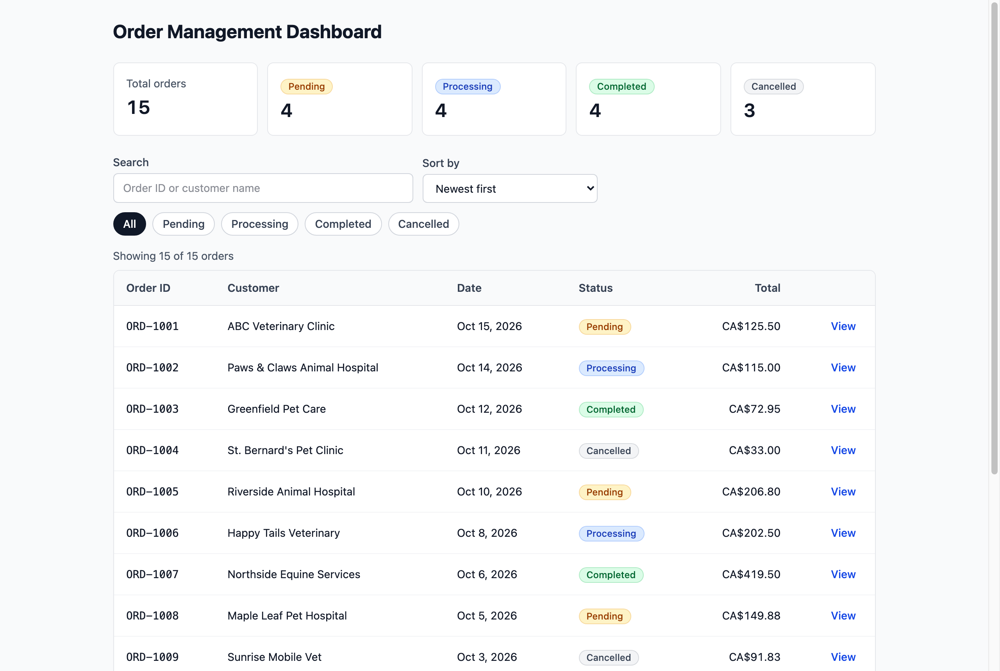
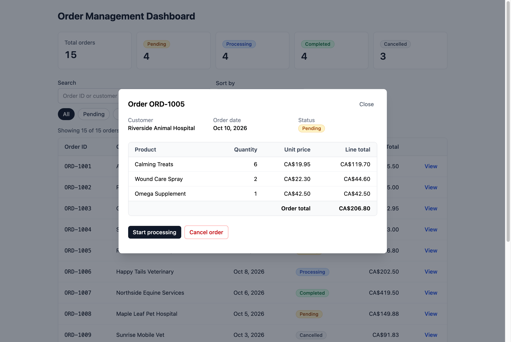
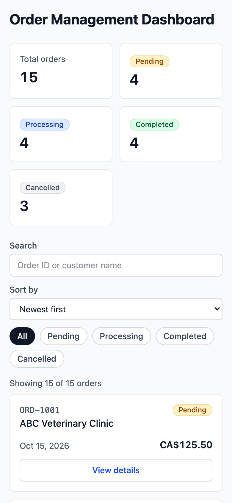

# Order Management Dashboard

A small full-stack app for looking after customer orders. You can see every order at a glance, search and filter them, open one to check its items, and move it through its lifecycle (Pending, Processing, Completed or Cancelled).

I built it for a second-round technical assessment. The frontend is React with TypeScript, and the backend is a REST API in Node.js and Express, also in TypeScript. There's no database: the 15 sample orders are fictional and live in memory while the API runs.



## Contents

- [Completed features](#completed-features)
- [Getting started](#getting-started)
- [Using the app](#using-the-app)
- [Running the tests](#running-the-tests)
- [Architecture](#architecture)
- [API reference](#api-reference)
- [Why I built it this way](#why-i-built-it-this-way)
- [Problems I ran into](#problems-i-ran-into)
- [Assumptions, limitations and incomplete features](#assumptions-limitations-and-incomplete-features)
- [What production would need](#what-production-would-need)
- [What I'd add next](#what-id-add-next)

## Completed features

Everything in the brief is done, both the mandatory Priority 1 work and the Priority 2 extras.

- The order list shows the ID, customer, date, status and total for every order, with a button to open the details. It has proper loading, error and empty states, and the error state has a retry button.
- Search matches order IDs and customer names, and the status buttons narrow the list down. They work together, and nothing reloads the page.
- The details view is a modal with the line items, quantities, unit prices, line totals and the order total. If an order can't be found, you get a message instead of a blank box.
- Status changes only offer what's allowed: Pending can go to Processing or Cancelled, and Processing can go to Completed or Cancelled. Completed and Cancelled orders are locked. The new status only appears once the API has confirmed it.
- Summary cards at the top count orders by status and update as soon as a status changes.
- You can sort by date, total or customer name, in either direction, while a search or filter is active.
- On a phone, the table turns into a list of cards so you never have to scroll sideways.
- It works with a keyboard and a screen reader. An axe-core scan came back with zero WCAG 2.2 AA issues.
- There are 21 automated tests: 12 for the frontend and 9 for the API.

## Getting started

You'll need Node.js 24, the version in `.nvmrc`. If you use [nvm](https://github.com/nvm-sh/nvm), run `nvm install` and then `nvm use` in the project folder and it will pick the right one. npm comes with Node.

### Install the dependencies

Run these from the project root. There are three `package.json` files (the root has the formatter, and the app code is split between `backend` and `frontend`), so it's three commands:

```bash
npm ci
npm ci --prefix backend
npm ci --prefix frontend
```

I use `npm ci` rather than `npm install` because it installs exactly what's in the lock files, so you get the same versions I tested with.

### Start the backend API

In one terminal, from the project root:

```bash
cd backend
npm run dev
```

You should see `API listening on http://localhost:3000`. It restarts by itself when you save a file. To check it's up, open http://localhost:3000/health.

### Start the frontend

In a second terminal, also from the project root:

```bash
cd frontend
npm run dev
```

Then open http://localhost:5173. The frontend talks to the API through Vite's dev proxy, so there's nothing to configure, but the API does need to be running first.

If port 3000 is taken, start the API with `PORT=4000 npm run dev` and change the proxy `target` in `frontend/vite.config.ts` to match.

One thing to know before you click around: the API loads `backend/data/orders.json` when it starts, so **restarting it puts every order back to its original status.** That's on purpose. It makes demos easy to reset.

You might see `npm warn install-scripts ... fsevents` during the frontend install. Newer versions of npm hold back dependency install scripts until you approve them, and fsevents is an optional macOS file watcher that ships prebuilt. Everything works without its script, so you can ignore the warning.

## Using the app

Open the dashboard and the summary cards tell you how many orders are in each state. Type in the search box to find an order by ID (`1005` is enough) or by customer name. The status buttons under it filter the list, and the "Sort by" menu changes the order.

Click "View" on any row to open the order. The buttons at the bottom move it to the next status, and only the moves that are allowed are shown, so a completed order has none. Press Esc, click outside the box or use "Close" to get back to the list.



On a narrow screen the same information is laid out as cards:



## Running the tests

From the project root, this runs both test suites:

```bash
npm test
```

You can also run one side at a time with `npm test --prefix backend` or `npm test --prefix frontend`. While working on the frontend, `npm run test:watch --prefix frontend` re-runs the tests every time you save.

The frontend tests use Vitest and React Testing Library. They cover searching, filtering by status, combining the two, sorting (including tie-breaks), and the status buttons: that a pending order only offers the right next steps, that a completed order offers none, and that the buttons are disabled while a change is saving. There's also a test that sorting never changes the original array, because swapping `toSorted()` for `sort()` would quietly modify React state and nothing else would notice.

The API tests use Node's built-in test runner and Supertest. They hit the real Express app without starting a server and check the status codes: 200 for good requests, 400 for invalid statuses, disallowed transitions and broken JSON, 404 for unknown orders, and 413 for oversized bodies. They also check that totals are calculated correctly and that an update is still there on the next request.

These are the other checks I run before committing:

| Command                              | What it checks                     |
| ------------------------------------ | ---------------------------------- |
| `npm run format:check`               | Prettier formatting, whole repo    |
| `npm run lint --prefix frontend`     | oxlint, including React hook rules |
| `npm run typecheck --prefix backend` | TypeScript for the API and shared  |
| `npm run build --prefix frontend`    | TypeScript and a production build  |

## Architecture

```text
.
├── shared/            types and status rules used by both apps
├── backend/
│   ├── data/          orders.json, the sample data
│   └── src/
│       ├── server.ts      starts the HTTP server
│       ├── app.ts         sets up Express: middleware, routes, error handling
│       ├── routes/        reads the request, sends the response
│       ├── services/      business logic: totals, status changes
│       ├── repositories/  the only code that touches the data
│       └── middleware/    404 and error handlers
└── frontend/
    └── src/
        ├── api/           fetch wrapper and one function per endpoint
        ├── hooks/         useOrders and useOrderDetails
        ├── components/    the UI pieces
        └── utils/         filtering, sorting, counting, formatting
```

The request path looks like this:

```text
React component ─▶ hook ─▶ api/ ─▶ /api/orders ─▶ Vite proxy ─▶ Express
                                                                   │
                                     route ─▶ service ─▶ repository ─▶ in-memory orders
```

The folder I'd point at first is `shared/`. It holds the order types and the table of allowed status changes, and both apps import it. The API uses that table to reject bad changes, and the UI uses the same table to decide which buttons to show, so the two can't disagree.

On the backend, each layer has one job. Routes deal with HTTP, the service holds the rules, and the repository owns the data. If the JSON file became a PostgreSQL table, only the repository would change.

On the frontend, the hooks own the data loading, and `App` owns the search, filter and sort settings. The visible list and the summary counts are worked out on every render from those, rather than stored as separate state that could drift out of sync.

## API reference

In development the API is at `http://localhost:3000`. Through the frontend it's at `/api`.

| Method  | Path          | What it does                                             |
| ------- | ------------- | -------------------------------------------------------- |
| `GET`   | `/orders`     | Lists every order as a summary with its total (no items) |
| `GET`   | `/orders/:id` | Returns one order with its items, line totals and total  |
| `PATCH` | `/orders/:id` | Changes the status. Send `{ "status": "Processing" }`    |
| `GET`   | `/health`     | Returns `{ "status": "ok" }` if the API is up            |

For example:

```bash
curl -X PATCH http://localhost:3000/orders/ORD-1001 \
  -H 'Content-Type: application/json' \
  -d '{"status":"Processing"}'
```

Every error comes back in the same shape, with a code a program can check and a message a person can read:

```json
{
  "error": {
    "code": "INVALID_STATUS_TRANSITION",
    "message": "Cannot change order ORD-1003 from Completed to Cancelled. Completed orders cannot be modified."
  }
}
```

| Status | Code                        | When                                                                    |
| ------ | --------------------------- | ----------------------------------------------------------------------- |
| 400    | `VALIDATION_ERROR`          | Broken JSON, or a status that doesn't exist                             |
| 400    | `INVALID_STATUS_TRANSITION` | The change isn't allowed from the current status                        |
| 404    | `ORDER_NOT_FOUND`           | No order with that ID                                                   |
| 404    | `ROUTE_NOT_FOUND`           | The path doesn't exist                                                  |
| 413    | `PAYLOAD_TOO_LARGE`         | The request body is over 10 KB                                          |
| 500    | `INTERNAL_ERROR`            | Something unexpected. Details go to the server log, never to the client |

## Why I built it this way

I went with Node and Express over .NET so the whole project is TypeScript. That's what makes `shared/` possible.

The API runs TypeScript directly. Node 24 can strip types itself, and that feature is now marked stable, so there's no build step for the backend. Node doesn't check types, though, so `npm run typecheck` runs `tsc` to do it.

For the frontend I used Vite rather than a framework like Next.js. It's one page with its own API, so a router and server rendering would have been extra weight for nothing.

I picked Tailwind over Material UI. It adds no styling code at runtime, it makes the phone layout easy, and it pushed me towards native elements like `<table>`, `<select>` and `<dialog>`, which are accessible without a component library. It also means every visual decision is in the code where I can explain it.

The frontend reaches the API through Vite's proxy instead of CORS. The browser only ever sees one origin, so the API doesn't have to open itself up to other websites. That also mirrors a typical production setup, where a reverse proxy serves the app and forwards `/api`.

Order totals aren't stored anywhere. The brief's example data has a `total` field, but a stored total can disagree with the items, so the API works it out from the items every time and sums it in whole cents.

Status changes are pessimistic: the UI waits for the API before it shows the new status. An optimistic update would feel a little faster, but it can show something that isn't true yet, and for orders I'd rather be accurate.

Data fetching is plain `fetch` inside two custom hooks. For an app this size that's easy to read and easy to explain. In a bigger app I'd reach for TanStack Query to get caching and refetching for free.

## Problems I ran into

A few bugs here taught me something, so I'm listing them.

Dates showed up a day early. `new Date('2026-10-15')` is midnight UTC, which is still the evening of the 14th anywhere in North America. Dates are now formatted in UTC as well, so they display as written.

Money didn't add up. In JavaScript, `19.95 * 3` is `59.849999999999994`. The API converts prices to cents, does the maths with whole numbers, and converts back at the end.

Focus got lost after a status change. The button you'd just clicked stopped being a valid action, so React removed it, and keyboard focus fell back to the page body. Focus now moves to the status section, and screen readers hear "Status updated to Processing."

Every request ran twice in development. That turned out to be React's Strict Mode deliberately mounting components twice to catch effects that don't clean up. The hooks use the cleanup pattern from the React docs, so the extra response is ignored, and production only makes one request.

The 413 test caught a real bug: I'd added the "payload too large" branch after the catch-all 500 response, so it never ran. Specific cases now come first, and the catch-all is last.

## Assumptions, limitations and incomplete features

There are no incomplete features. These are the assumptions I made and the limits I know about:

- Amounts are in Canadian dollars, formatted with US English rules, so they read `CA$125.50`.
- Data lives in memory. Changes last until the API restarts.
- There's no login. The brief didn't ask for one.
- If two people change the same order at the same moment, the last one wins. The server still refuses a change that's no longer allowed, but it doesn't warn about conflicts.
- All orders load at once with no paging. That's fine for 15 orders, and not fine for 15,000.
- There's only a light theme.
- Each product appears at most once per order, and the item rows rely on that.
- Cancelling an order doesn't ask "are you sure?"
- The Vite proxy only exists in development. A real deployment needs a reverse proxy, or CORS with a list of allowed origins.
- Everything runs over plain HTTP locally.

## What production would need

The brief says deployment isn't needed, so none of this is built. If it were going live, I'd start here:

- HTTPS, ended at a reverse proxy like Nginx with a Let's Encrypt certificate. The same proxy would serve the built frontend and forward `/api` to Express.
- A database such as PostgreSQL behind the repository layer, with a version column or transactions to handle two people editing the same order.
- Searching, filtering and paging done by the API (`/orders?status=Pending&q=abc&page=2`) once the data gets big.
- `NODE_ENV=production`, something to restart the API if it crashes, and proper logging with a library like Pino instead of `console`.
- Authentication, rate limiting, and a CI pipeline that runs the formatter, linter, type checks, tests and build on every push.

## What I'd add next

I'd like the filters and sort order to live in the URL so a filtered view can be bookmarked or shared. A confirmation step before cancelling would prevent accidents. I'd also like a test for the whole page with the API mocked, a dark theme, and an order history that shows who changed a status and when.

## Credits

Built by Nishant Jagtap. The sample customers and products are made up.

The decisions above lean on the official docs for [React](https://react.dev), [TypeScript](https://www.typescriptlang.org/docs/), [Vite](https://vite.dev), [Express](https://expressjs.com) (especially the security and performance guides), [Tailwind CSS](https://tailwindcss.com/docs), [Vitest](https://vitest.dev), [Testing Library](https://testing-library.com) and [MDN](https://developer.mozilla.org).

Use of AI tools, I used Microsoft Copilot, Claude. Planning and gathering information to help me decide on what to use, for example Tailwind vs Material UI and the proxy vs CORS. Code: Copilot wrote and suggets some of the code snippet based and helped me complete the code. Used Claud to generate data for this project. Documentation: Used Claude to help me draft this README, which I reviewed and edited.

This repository was written for a technical assessment and doesn't have an open source license.
